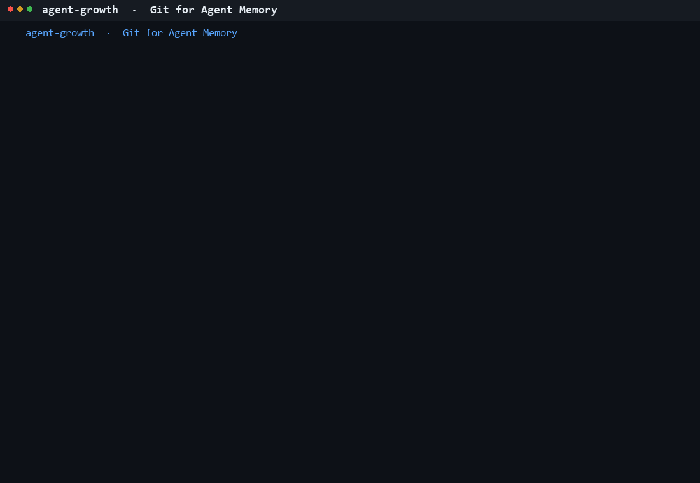

# agent-growth

**Git for Agent Memory — versioned, conflict-checked, rollback-able rules for Claude Code & Cursor. Zero extra API key.**

[中文](./README_ZH.md)



```bash
pip install git+https://github.com/simin-yuan/agent-growth.git && growth init --target claude
```

Your agent remembers. But does it get *better* — and can you prove it?

Most "AI memory" stores facts. `agent-growth` stores **rules learned from your corrections**, versioned in Git, conflict-checked, and revertible with one command. It is the missing *governance* layer between "the agent remembered something" and "the agent is trustworthy enough to keep improving."

> Memory is not growth. Trustworthy growth = correction → rule → reviewable, conflict-checked, revertible.

---

## The 4 things a `CLAUDE.md` can't do

| Capability | `CLAUDE.md` / `.cursorrules` | Mem0 | **agent-growth** |
|---|---|---|---|
| Auto-capture from corrections | manual edit | ✅ | ✅ |
| Conflict isolation (never pollutes the prompt) | ❌ rules just pile up | ❌ | ✅ |
| Git rollback in one command | ❌ | ❌ | ✅ |
| Zero extra API key | — | ❌ | ✅ (MCP mode) |

And it is **plain local files + Git** — no vector DB, no server, no lock-in.

---

## Why

Every self-evolving agent today has the same black hole: **it changes, but you can't see what changed, why, or undo it.** That is not growth — that is drift.

`agent-growth` fixes the four things that make agent growth untrustworthy:

| Problem | What this layer does |
|---|---|
| "It forgot my correction next session" | Rules persist in a Git repo and are injected into every prompt |
| "It got worse and I can't tell why" | Every rule is a commit with source + timestamp |
| "Two corrections now contradict" | New rules are conflict-checked before they go active |
| "I want the old behavior back" | `growth rollback <id>` — literally `git revert` |

---

## 30-second demo

```bash
$ growth add "comments in Chinese"
stored 20261124-031500-a1b2c3: comments in Chinese (status=active)

$ growth add "comments must be English"
stored 20261124-031600-d4e5f6: comments must be English (status=conflict)
!! conflict: contradicts a1b2c3 (comments in Chinese)
run `growth conflicts`, then `growth resolve <id> --keep-new|--keep-old|--keep-both`

$ growth resolve 20261124-031600-d4e5f6 --keep-new
{"id": "20261124-031600-d4e5f6", "action": "keep-new", "superseded": ["20261124-031500-a1b2c3"]}

$ growth rollback 20261124-031600-d4e5f6
reverted 1f3c2a1
```

The conflicting rule never touches the prompt until you decide. After `resolve`, `git log` shows exactly what changed and why.

---

## Install

```bash
pip install git+https://github.com/simin-yuan/agent-growth.git
growth init --target claude     # writes .mcp.json
growth init --target cursor     # writes .cursor/mcp.json
```

Requires Python 3.9+ and `git` on PATH. No other dependencies.

---

## Zero API key (MCP mode)

Inside Claude Code / Cursor, the host model already *is* a strong LLM — you should not need a second key.

`growth_learn` accepts host-computed values:

- `rule` — one clear sentence the host extracted from the correction
- `conflicts_with` — ids of existing rules it contradicts (`[]` if none)

The host already calls `growth_get_rules`, so it has everything it needs. Result: **full extraction + conflict interception with no `GROWTH_LLM_KEY`, no extra token cost.**

A standalone CLI / offline mode still works; set `GROWTH_LLM_KEY` only if you want server-side extraction:

```bash
export GROWTH_LLM_KEY=sk-...
export GROWTH_LLM_BASE_URL=https://api.deepseek.com/v1
export GROWTH_LLM_MODEL=deepseek-chat
```

---

## CLI

```bash
growth add "<correction>" [--context TEXT]   # extract + conflict-check + store a rule
growth rules                                 # print the active rules block
growth conflicts                             # show unresolved conflict rules
growth resolve <id> --keep-new|--keep-old|--keep-both
growth log [-n 20]                           # rule history
growth rollback <id>                         # git revert a rule
growth inject [--out prompt.md]              # write the rules block to a file
growth init --target claude|cursor|both [--dry-run]
growth mcp                                   # run as an MCP server over stdio
```

---

## Use it from Claude Code / Cursor (MCP)

```bash
growth init --target claude     # or cursor / both
```

The agent then gets five tools:

- `growth_get_rules` — pull the current rules into context
- `growth_learn` — record a correction (`rule` + `conflicts_with` for zero-key mode)
- `growth_resolve` — decide a conflict: `keep-new` / `keep-old` / `keep-both`
- `growth_rollback` — undo a rule
- `growth_log` — inspect history

A minimal loop:

1. Agent does a task.
2. You correct it once.
3. The agent calls `growth_learn` on its own, passing the extracted rule.
4. Next session it calls `growth_get_rules` first — and stops making that mistake.

If a correction contradicts an existing rule, the agent gets `status=conflict` back, asks you which one wins, then calls `growth_resolve`.

---

## How it works

```
correction ──▶ extract (host or LLM) ──▶ conflict check ──▶ store (Git commit)
                                                              │
                              prompt injection ◀── rules block ┘
                                      │
                         resolve = keep-new / keep-old / keep-both
                                      │
                              rollback = git revert
```

- **Storage**: `.growth/rules/*.md`, one file per rule, frontmatter = metadata.
- **History**: the `.growth/` directory is its own Git repo. `git log` is the audit trail.
- **Safety**: conflicting rules are stored with `status: conflict` and are never injected until resolved.
- **Integration**: plain prompt block + MCP tools. No vendor lock-in.

A rule file looks like this:

```markdown
---
{
  "id": "20261124-031500-a1b2c3",
  "created": "2026-11-24T03:15:00",
  "source": "mcp",
  "status": "active"
}
---

Never use emojis in code comments.
```

---

## Tests

```bash
python -m unittest discover -s tests -v
```

Covers: add → active, conflict gate, `keep-new` / `keep-old` / `keep-both`, rollback restore, MCP surface, zero-key conflict interception.

---

## Roadmap

- [ ] Rule decay: age out stale rules, surface them for review
- [ ] Team mode: shared rule repo with per-author attribution
- [ ] Diff view: render a rule's full evolution
- [ ] Web UI for conflict review

---

## License

MIT.
