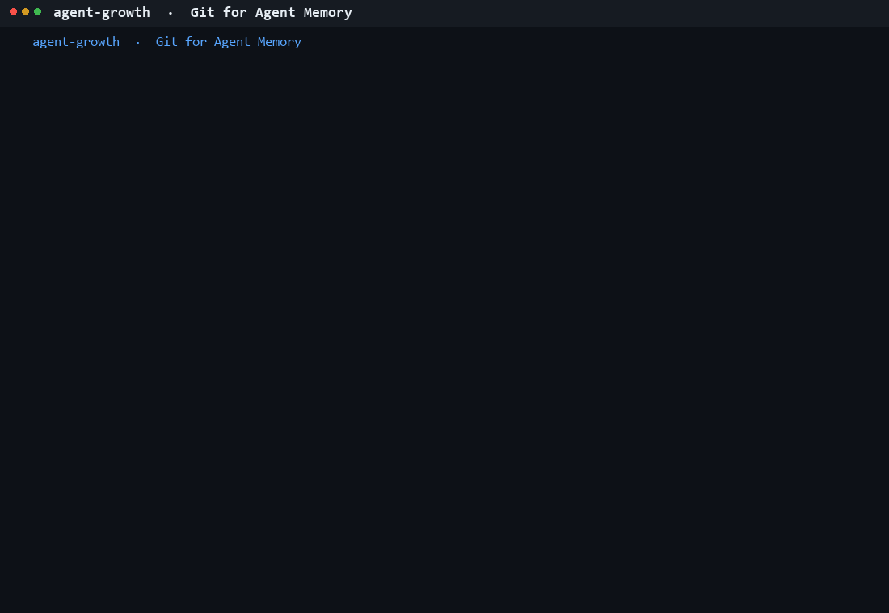

# agent-growth

[](https://glama.ai/mcp/servers/simin-yuan/agent-growth)

**给 Agent 记忆装上 Git —— 面向 Claude Code / Cursor 的版本化、冲突拦截、可回滚规则层。零额外 API Key。**

[English](./README.md)



```bash
pip install git+https://github.com/simin-yuan/agent-growth.git && growth init --target claude
```

AI 会记住，但它会**变好**吗？你能证明吗？

大多数「AI 记忆」存的是事实。`agent-growth` 存的是**从你的纠正里提炼出的规则**：进 Git、可审查、冲突拦截、一条命令回滚。它是「AI 记住了点什么」和「这个 AI 可信到可以持续变强」之间缺失的那层**治理**。

> 记住 ≠ 成长。可信的成长 = 纠正一次 → 沉淀一条规则 → 可审查、可冲突检测、可一键回滚。

---

## CLAUDE.md 做不到的 4 件事

| 能力 | `CLAUDE.md` / `.cursorrules` | Mem0 | **agent-growth** |
|---|---|---|---|
| 从纠正中自动捕获 | 手动编辑 | ✅ | ✅ |
| 冲突隔离（不污染 prompt） | ❌ 规则越堆越乱 | ❌ | ✅ |
| 一条命令 Git 回滚 | ❌ | ❌ | ✅ |
| 零额外 API Key | — | ❌ | ✅（MCP 模式） |

而且是**纯本地文件 + Git**——没有向量库、没有服务端、不锁定。

---

## 为什么需要它

今天所有「自进化 Agent」都有同一个黑洞：**它变了，但你看不到变了什么、为什么变、也撤不回来。** 那不叫成长，叫漂移。

`agent-growth` 修掉让 AI 成长不可信的四个问题：

| 问题 | 这层做什么 |
|---|---|
| 「它下次会话就忘了我的纠正」 | 规则存在 Git 里，每次注入 prompt |
| 「它越用越差，我不知道为什么」 | 每条规则都是一次带来源和时间的 commit |
| 「两条纠正互相打架」 | 新规则入库前先做冲突检测 |
| 「我想恢复以前的行为」 | `growth rollback <id>` —— 就是 `git revert` |

---

## 30 秒演示

```bash
$ growth add "注释用中文"
stored 20261124-031500-a1b2c3: 注释用中文 (status=active)

$ growth add "注释全用英文"
stored 20261124-031600-d4e5f6: 注释全用英文 (status=conflict)
!! conflict: contradicts a1b2c3 (注释用中文)
run `growth conflicts`, then `growth resolve <id> --keep-new|--keep-old|--keep-both`

$ growth resolve 20261124-031600-d4e5f6 --keep-new
{"id": "20261124-031600-d4e5f6", "action": "keep-new", "superseded": ["20261124-031500-a1b2c3"]}

$ growth rollback 20261124-031600-d4e5f6
reverted 1f3c2a1
```

冲突规则在你裁决前**绝不进入 prompt**。裁决后 `git log` 完整记录改了什么、为什么。

---

## 安装

```bash
pip install git+https://github.com/simin-yuan/agent-growth.git
growth init --target claude     # 写 .mcp.json
growth init --target cursor     # 写 .cursor/mcp.json
```

需要 Python 3.9+ 和 PATH 里的 `git`，无其他依赖。

---

## 零 API Key（MCP 模式）

在 Claude Code / Cursor 里，宿主模型本身就是顶级 LLM——你不该再配第二个 key。

`growth_learn` 接收宿主算好的值：

- `rule` —— 宿主从纠正里提炼出的一句话规则
- `conflicts_with` —— 与之冲突的已有规则 id 列表（没有就给 `[]`）

宿主本来就会调 `growth_get_rules`，信息齐了。结果：**免 `GROWTH_LLM_KEY`、免额外 token 费用，完整触发提炼 + 冲突拦截。**

独立 CLI / 离线模式仍然可用；只有想让服务端提炼时才需要配：

```bash
export GROWTH_LLM_KEY=sk-...
export GROWTH_LLM_BASE_URL=https://api.deepseek.com/v1
export GROWTH_LLM_MODEL=deepseek-chat
```

---

## CLI

```bash
growth add "<纠正>" [--context 文本]        # 提炼 + 冲突检测 + 入库
growth rules                                # 打印生效规则块
growth conflicts                            # 展示未裁决的冲突规则
growth resolve <id> --keep-new|--keep-old|--keep-both
growth log [-n 20]                          # 规则历史
growth rollback <id>                        # Git 回滚一条规则
growth inject [--out prompt.md]             # 把规则块写到文件
growth init --target claude|cursor|both [--dry-run]
growth mcp                                  # 以 MCP server 运行（stdio）
```

---

## 在 Claude Code / Cursor 里用

```bash
growth init --target claude     # 或 cursor / both
```

Agent 获得 5 个工具：

- `growth_get_rules` —— 拉取当前规则
- `growth_learn` —— 记录纠正（零 Key 模式传 `rule` + `conflicts_with`）
- `growth_resolve` —— 裁决冲突：`keep-new` / `keep-old` / `keep-both`
- `growth_rollback` —— 撤销一条规则
- `growth_log` —— 查看历史

最小闭环：

1. Agent 干活。
2. 你纠正它一次。
3. Agent 自己调 `growth_learn`，把提炼好的规则传进去。
4. 下次会话它先调 `growth_get_rules` —— 同样的错不再犯。

如果新纠正和旧规则矛盾，Agent 拿到 `status=conflict`，问你哪条赢，再调 `growth_resolve`。

---

## 它怎么工作

```
纠正 ──▶ 提炼（宿主或 LLM）──▶ 冲突检测 ──▶ 入库（Git commit）
                                              │
                          规则块注入 prompt ◀──┘
                                │
                   裁决 = keep-new / keep-old / keep-both
                                │
                       回滚 = git revert
```

- **存储**：`.growth/rules/*.md`，一条规则一个文件，frontmatter 为元数据
- **历史**：`.growth/` 本身就是 Git 仓库，`git log` 就是审计轨迹
- **安全**：冲突规则以 `status: conflict` 存储，裁决前绝不注入
- **接入**：普通 prompt 块 + MCP 工具，不绑定任何厂商

---

## 测试

```bash
python -m unittest discover -s tests -v
```

覆盖：add → active、冲突拦截、keep-new / keep-old / keep-both、回滚恢复、MCP 工具面、零 Key 冲突拦截。

---

## Roadmap

- [ ] 规则衰减：让过时规则自动浮出待审
- [ ] 团队模式：共享规则仓库 + 按作者归因
- [ ] Diff 视图：展示一条规则的完整演化
- [ ] 冲突裁决 Web UI

---

## License

MIT.
